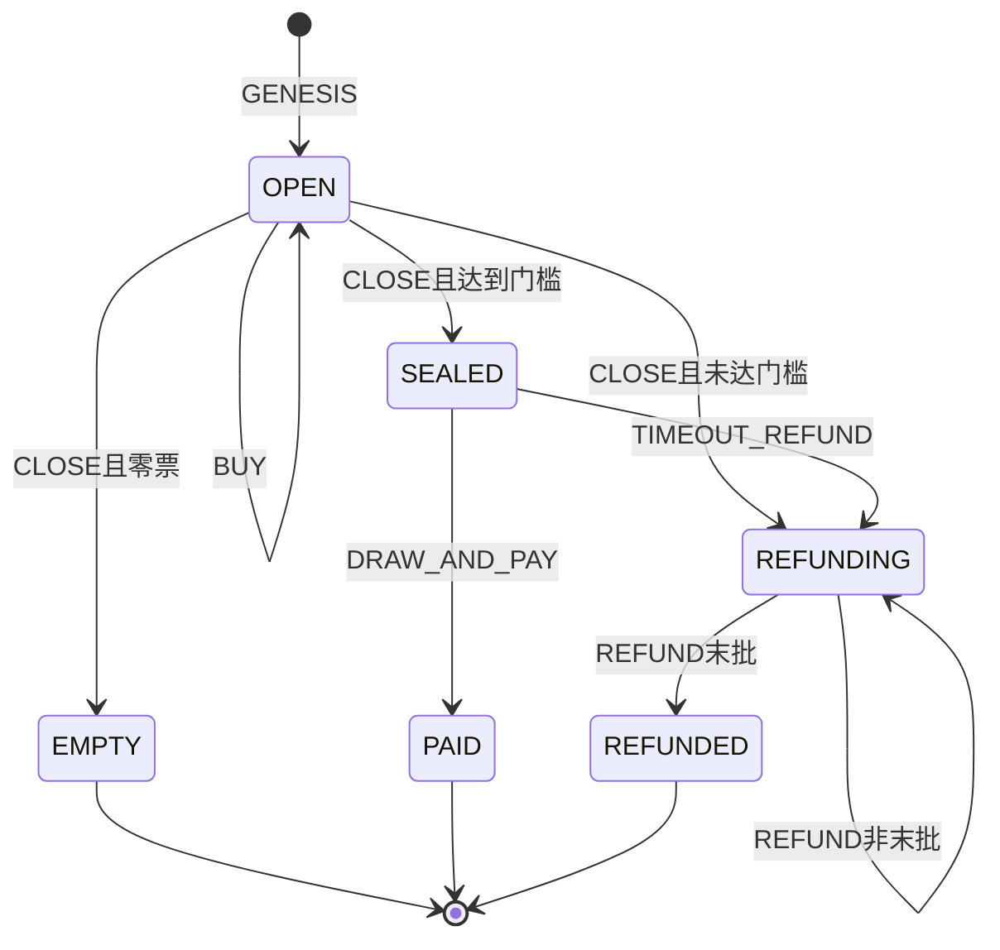
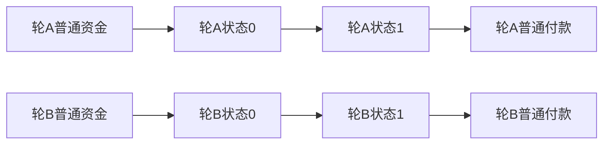

# KCI Indexer 源码排查：停追、证据补全与恢复入口

日期：2026-10-17 UTC。状态：**REVIEW COMPLETE / 5项OPEN；仅审查，不授予实现或生产批准**。

用户要求“indexer 出问题了，去检查下它的代码”。本次只读检查源码、既有systemd日志/状态及SQLite查询；未改运行代码、未写服务数据库、未启动/重启服务、未调用管理接口、未执行测试/构建/浏览器/VM/链上实验，无钱包读取、签名广播或commit/push。

## 审查基线与边界

- 独立源码：`/root/kaspa-covenant-indexer`，HEAD `73fcd33e830e527ed2972702ea3d7a344552f7c6`；`src/engine.mjs`已有未提交改动，**不能只用HEAD描述本次所审代码**。
- 本次engine文件SHA256 `e61f44084cda6a5834965d3bf6e6e8276cc7dbfc6bad6577fbf0bb4ab5a2c22c`；工作空间worker副本、独立仓库及`/opt/kaswin-event-indexer/workers/kaswin-event-indexer/src/engine.mjs`在比对时相同。adapter SHA256 `bd58fac13f248bd077d351f4bfd3c1280ff022fbe9545d2df27c44c5db2e97ac`，独立仓库与部署副本相同。
- 其他已审文件：`admin.mjs` SHA256 `911b7854cb127c3f3657cafaa73f5cfb05337be2bf04137c5eaf281f8bfdb506`；`tracer.mjs` `d9f373b48cbffeb063ef23a38f6ecd0f1de375e883f70d7aee1e7735a0e0b1a1`；`dual-node.mjs` `26aec4406f2c55c22e56606cbb1954f3306df20fd284ac9ae585821c0cd6f104`。
- 额外阅读：indexer入口、node/rpc、store/api、normalize、window-scan/worker、contracts/plugin、固定core的accepted解释器及既有多网络Preflight。编译器/插件安装器/全部core与历史版本没有完整审计。
- 固定V2.0.2/Profile `ed0387c9e77bb4e0a8f1f4654a326c316d83663f455283ec6a046a095c94856d`；原SilverScript `3ed973…`、共识来源 `cfafeb4…`不升级。既有运行日志报节点2.1.0，未据此授予当前RPC/行为兼容结论。
- 数据来源是本机服务的`/var/lib/kaswin-event-indexer/events.tn10.sqlite`，用SQLite `mode=ro`查询。**未确认网页当前使用的jp.cd311.cn是否由这份数据库提供服务**，未探测公网API/DNS或查询节点。
- 排查期间观察到外部写入和重启：原PID1046809退出，后续PID1074636，服务ActiveEnterTimestamp为2026-10-18 00:28:39 CST（16:28:39 UTC）；engine部署文件mtime同为16:28:39 UTC。这些动作不是本轮执行；磁盘同哈希不代表旧进程内存中曾加载相同源码。
- 证据：**S=源码**；数据库/日志是既有运行记录的只读观察，不是重新执行网络验收。L/V/N实验均NOT_RUN。下列txid没有重新核验accepted、mass、fee，不作为新增完整N回执。

## 范围Preflight：25问

已读工作空间核心架构规范及25/14/8模板。下表界定审查依据；“清楚”不代表所审实现通过。

|#|答案/依据/状态|
|---|---|
|1|实例identity为规范OPEN lineage CID；网络genesis是链下隔离维度，不冒充CID。清楚。|
|2|authorizing outpoint与规范OPEN组输出推导；沿用固定genesis-discovery/core。清楚。|
|3|同轮唯一合法状态后继继承；终局无covenant后继。清楚。|
|4|Current State在链上live UTXO；SQLite不是当前权益证明。清楚。|
|5|owner/config/Profile/origin保持原约束。清楚。|
|6|phase/sold/purchaseCount/cursor/directory为共识状态；队列、重试、STALE为Derived/Cached。清楚。|
|7|GENESIS、BUY、CLOSE、DRAW_AND_PAY、TIMEOUT_REFUND、REFUND。清楚。|
|8|合约原授权/条件；Indexer没有签名或广播权。清楚。|
|9|创建资金→状态/登记，普通更新1→1，终局1→0。清楚。|
|10|状态output0或规定普通付款；其它输出保持固定解释器边界。清楚。|
|11|规范state/template/P2SH重算；不能以REST输出替代。依据清楚，R2 OPEN。|
|12|input0、CID、authorizingInput与完整family集合核对。依据清楚，R2 OPEN。|
|13|固定accepted解释器复算后继账本、SPK、value；缺字段应未知。R1/R2 OPEN。|
|14|完整接受实例、正确谱系、线索不作证据、未知不判规则违例、网络隔离。R1/R2/R4 OPEN。|
|15|bigint守恒、真实input amounts/fee与付款约束；不能默认缺失共识字段。R2 OPEN。|
|16|同轮状态输入由参与者竞争，原single-consumption不变。清楚。|
|17|每轮最多256目录记录的原约束；本地全网络队列另有活性竞争。R5 OPEN。|
|18|跨轮独立；链外读取可按轮合并/切片，SQLite写入仍单写入者。清楚。|
|19|EMPTY/PAID/REFUNDED；STALE不是链上终局。清楚。|
|20|创建者/中奖者/退款买家/执行者普通付款按原规则；索引故障不能改变出口。清楚。|
|21|发现、接受观察、历史、后继缓存、重组撤销与API。R1/R3/R4/R5 OPEN。|
|22|Indexer消失不改变UTXO/资金/权利；历史材料缺失仍可导致不可核验，不能伪造。清楚。|
|23|跨OPEN/SEALED/REFUNDING模板按固定family验证，不新增foreign规则。R2涉及证据完整性。|
|24|本次不新增multi-contract流；固定插件拒绝其它拓扑。N/A。|
|25|只读基础设施审查，不把链外队列或索引当Based App/L1扩容。N/A。|

## 14项架构材料

1. **Inventory**：每轮状态UTXO；GENESIS普通资金与登记；后继普通找零；终局付款。无新增链上对象，缓存/任务不是UTXO。
2. **Schemas**：Consensus为KW21规范ledger、CID/binding、SPK/value及交易字段；immutable为Profile/origin/owner/config；mutable为phase/票数/目录/cursor。Derived为插件复算结果、当前tip接受上下文；Cached为rounds/transitions/checkpoints/discoveries/outbox/journal；External为REST/通知位置。金额bigint/十进制字符串。
3. **Lineage**：规范Genesis→精确input0消费→固定模板/witness→完整family后继或规定普通付款。txid不承诺signatureScript，候选同txid不足以证明是实际接受witness；R2未闭合。
4. **状态图**：如下，链外STALE不在共识状态图内。

5. **Topology**：不同轮次状态互不消费；Indexer链外维护独立网络DB，单Engine队列不应成为所有轮次长期读取屏障。

6. **逐转换I/O**：见表；auth/cov为状态继承集合，登记/付款/找零为普通输出，不混算为后继。

|转换|输入与输出边界|
|---|---|
|GENESIS|1–8普通创建资金→规范OPEN状态output0、可选登记/普通找零；验证origin/CID/初态。|
|BUY|状态input0＋普通资金→唯一状态output0＋普通找零；目录追加与锁定票款。|
|CLOSE|状态input0＋普通资金→唯一SEALED/REFUNDING后继；零票则普通创建者付款、无后继。|
|DRAW_AND_PAY|SEALED状态→中奖者、创建者、执行者3个普通付款；无family后继，实际接受共识负责原生PoW accessor。|
|TIMEOUT_REFUND|SEALED状态及允许的资金→REFUNDING唯一后继与允许的普通输出；原sequence/DAA门保持。|
|REFUND|状态与允许的资金→最多32笔买家退款及执行者；非末批output0后继，末批创建者付款且无后继。|

7. **Auth**：只读索引不得新建/签名/重发交易；逐转换授权由原脚本决定。公开track不是接受证明；管理恢复也须绑定明确网络，R4 OPEN。
8. **Successor**：`accepted.interpretAccepted`检查完整family集合、output0 SPK/value/binding与ledger；terminal检查零family后继和普通收款。字段不全或witness未绑定应停止证据采用，R2 OPEN。
9. **Invariants**：同网络/Profile、连续谱系、接受实例绑定、真实费用、索引不裁权益、未知不冒充规则失败、恢复不跳过历史转换。R1/R2/R4未闭合，不能授予实现安全通过。
10. **Exit**：EMPTY押金退创建者；PAID奖池给中奖者、押金给创建者、赏金给执行者；REFUNDED按记录退款及规定费用。缓存STALE不构成资金退出，也不证明链上失败。
11. **Indexer**：通知/REST只定位；节点完整接受体＋插件解释＋live/terminal检查后事务写rounds/transitions/outbox；相关接受块离链撤销。发现覆盖声明为notification/manual，`scanDiscoveries`未被常驻计时器调用，不声称完整发现。
12. **Contention**：链上同轮天然竞争，跨轮独立；链外每网络所有轮次共享Promise队列，长RPC/窗口影响其它轮次，R5。不得通过并发多写DB解决读取活性。
13. **L1/Based**：不改变既有L1应用，不新增全局共享状态或证明系统。节点信任、历史剪枝与材料可得性仍是基础设施边界。
14. **Anti-pattern**：见下表；发现未解决，不因表格齐全而批准实现。

|#|anti-pattern|本轮结论|
|---|---|---|
|1|全局状态管全部用户|未新增链上全局UTXO；链外队列活性另见R5。|
|2|只验签不验后继|固定解释器有后继/付款检查；本轮不替代VM或全合约审计。|
|3|同CID即信状态|插件原有模板/账本检查；R2证据失配仍可误用候选，OPEN。|
|4|Indexer裁定权益|API声明独立核验；R1把内部解析异常当STALE，污染可用性/展示，OPEN。|
|5|EVM逐字段storage翻译|本轮没有此改动。|
|6|为方便共享UTXO|跨轮链上独立；单写DB是链外需要，不能要求长读全部串行。|
|7|无终局退出|三终局存在；但链外STALE缺恢复闭环，R1。|
|8|只验bytes不验模板/谱系|原解释器核验；R2吞掉接受实例补全失败，OPEN。|

## 发现（按影响排序）

### R1 / P1：解析异常被永久当成STALE，停追后没有恢复闭环

证据：`src/engine.mjs:616`的`applySpend`捕获所有`plugin.advance/checkRound`异常，执行`markStale`并退订旧地址；`markStale`在:674写status=STALE。`start/onUtxosChanged/reconcile`只取LIVE；`resolveSpend`也拒非LIVE。`discoverGenesisAttempt`在:728对既有非ROLLED_BACK轮次直接KNOWN；`tracer.mjs:14/35`对已知txid/Genesis直接去重返回，:144只对LIVE追加追赶。因此修掉字段解析或重启服务，都不会自动修复这些轮次。

2026-10-17 16:30:58 UTC只读快照：37 LIVE、4 STALE、62 TERMINAL；四个STALE日志如下。这里的txid是索引器报错对象，**accepted/mass/fee均未重新核验**。

|CID|报错交易txid|日志错误|UTC|
|---|---|---|---|
|a53ad03940216dafad09eeb2d7ae266dd50f2dd72312c761fc945b0441ae7acd|7b3525e590e310da759a8a83aa39b9fecf3b7992cd3a6e6c7675df6717057f4b|Cannot convert null to a BigInt|15:09:24.799|
|34cae1520fc77229dc83d9798485d302ef3f82d3798146b48e599fbafc1b7061|c9c2117a6b342bcd0efffcd96cbe700c25452fbbb873b84311364157002f0528|Cannot convert null to a BigInt|15:13:31.145|
|2c80e0221e21dd9accfb5a26d9c79ed67d4764e37b1ed33e2fa6e0406938b010|d8e7f76dd48717c933dc250b0d964d1d61e1cb4e97a6a2be631b7620c8398fab|Cannot convert null to a BigInt|15:19:22.327|
|1f7a302a5921bb30a059c0332458ac9d2553b83ee54c10f95538a66a82938be7|2b87df1f0d9bc13fa3eaa3690ac08a5f992fac94b7b34d3648c8ab69899e81ed|SUCCESSOR_MISMATCH|16:05:50.558|

其中后三类创建后仍显示OPEN旧阶段，第一类停在REFUNDING。日志没有错误堆栈/完整失败候选，不能从这几行断言具体哪个null字段或哪个后继子条件错误。`SUCCESSOR_MISMATCH`在固定core `accepted.js:212`同时覆盖family数量、authorizingInput、SPK、value，不能只凭该码断定某一个字段或链上非法。

整改方向：内部异常/缺证据进入可重试未知状态；只有完整、同接受实例的充分证据才能判规则不匹配。对已误标轮次提供同网络、原Profile、从最后已核验状态重新读节点并逐步推进的恢复，不直接把SQL改LIVE当作状态已恢复。**本轮未实施**。

### R2 / P1：补全失败被吞掉，继续使用未绑定接受实例的候选

证据：当前未提交补丁`src/engine.mjs:811–813`：当source为REST或候选inputs/outputs/payload与节点High不同，执行`try { tx = await this.hydrate(high.tx); ... } catch {}`；失败后保留原candidate.tx，并继续进入`applySpend`。它会吞掉`HIGH_FULL_MISMATCH_*`、正文缺失与网络错误，撤销了原先“不匹配则必须取得实际接受witness”的门。

此外:954的`normalizeConsensusFields`把缺失version/lockTime/gas/sequence/SPK version等填成1或0；这是项目猜测，不能替代节点完整正文。`isFullTransaction`也只检查少数字段，不能保证adapter中所有BigInt和input amount上下文完整。

影响：可以再次把不完整/不对应的候选送进解释器并触发R1；也损害txid不包含signatureScript时的实际接受实例绑定。日志中的`SUCCESSOR_MISMATCH`与此路径有相容解释，**但本轮未取得该笔失败候选，不能宣称已证明其唯一根因**。当前补丁晚于该条日志，不能反过来把新catch解释成早先事故的执行路径。

整改方向：补全失败停止采用候选并保留可重试任务；获取实际节点Full/正文及必要input UTXO上下文，不静默默认共识字段，不降低原模板/费用/谱系检查。**本轮未实施**。

### R3 / P2：“重审发现”没有重置attempts，会立即再次IGNORED

证据：`src/admin.mjs:265–274`只把IGNORED设为PENDING并清error，不重置attempts；`engine.mjs:711`在attempts≥40时直接IGNORED，异常路径:721从既有attempts≥14起也会忽略。只读快照确有1条IGNORED，attempts=4190、error=EXCEEDED_MAX_ATTEMPTS。

因此UI返回“已重置/自动追块”不证明任务真正被重新审查。次数4190的历史来源本轮未重建，不能全部归因于此按钮；也未证明该候选实际是合法Genesis。

整改方向：有界、退避、区分暂时错误与确定非目标；主动重新审查应给任务新的受限重试轮次，不能仅改status；与R1现有轮次恢复分开。**本轮未实施**。

### R4 / P2：部分管理诊断/恢复忽略所选network，实际用第一网络

证据：`src/admin.mjs`多数只读路由调用`pickView`，但`/probe-rest`(:234)、`/recheck-discoveries`(:265)、`/track`(:278)直接用外层ctx.store/engine；入口`indexer.mjs:229`的ctx由live[0]提供。于是选择mainnet时，这些路径仍可能操作TN10视图。`tracer.mjs:58`还在restUrl缺失时回退TN10 REST，显式禁用/缺失网络上下文没有失败关闭。

影响是错误网络的任务/诊断与误导性结果；没有证明已跨库污染主网共识状态，插件/节点已有校验不能因此省略。整改方向是每条路由先解析并固定视图，REST禁用保持禁用。**本轮未实施，未请求这些接口**。

### R5 / P2：全Engine串行长读及提前删除pending，造成跨轮阻塞与恢复退化

证据：`engine.run`(:68)让同网络所有发现、spend、reconcile、finality共享Promise队列；`acceptance`(:446)每个start扫描预算600000ms，而20秒slice只覆盖windowFind，不是整个resolveSpend。`dual-node.mjs:140`订阅等待两节点allSettled，慢备用也会拖住提交/退订。`resolveSpend`在:568/:585先删pending再bind/apply；后续RPC失败由run仅记ERROR，没有统一恢复pending。

影响：其它轮次可能等待长读；一次定位后补全失败可失去5秒retryPending覆盖，退到60秒reconcile。不能据此断言用户61118ms由Indexer造成，也未测量本次延迟。整改方向是共享单轮任务、主节点证明不等备用、有界读与可恢复失败；保留单写DB事务。**本轮未实施**。

## 处理顺序与未闭合项

先闭合R2的完整证据门，再完成R1的错误分类与现有四轮恢复；R3/R4修恢复入口的真实语义；R5改善有界追赶。恢复时必须重新取节点证据，不能用本地客户端回执/REST状态覆盖数据库。

必要的后续执行验收包括：缺字段/正文不一致不变STALE且保留重试；实际错误后恢复；已误标轮次逐转换回放；高attempt主动重审；mainnet管理路由不碰TN10；慢备用及一轮长读不拖住其它轮次。**本轮均NOT_RUN，没有新增测试或执行验证**。

未闭合：四笔交易当前真实acceptance/mass/fee；具体失败字段；网页jp端点与本机实例对应关系；外部修改后的完整运行效果；真实重组/长跑/独立安全审查。不把本机数据库的STALE等同链上失败、合约资金损失或协议无效。
